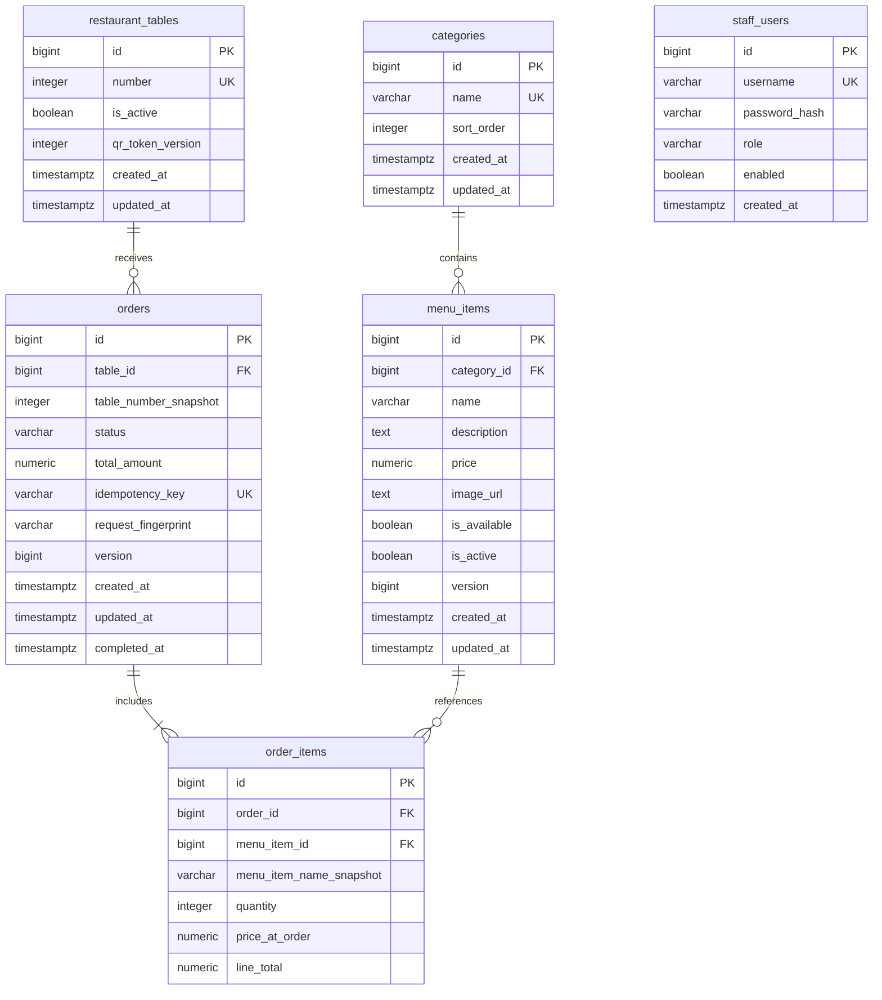

# Архитектура и данные

Модульный монолит в com.restaurant.ordering. Controllers принимают DTO и вызывают services; services управляют транзакциями и бизнес-правилами, repositories работают с JPA/PostgreSQL. Сущности не возвращаются в HTTP и STOMP.

```text
common/       config, единые Problem Details, request limits, timestamps
category/     controller, dto, entity, repository, service
menu/         controller, dto, entity, repository, service
order/        controller, dto, entity, repository, service
table/        controller, dto, entity, repository, service, qr
security/     config, controller, dto, entity, repository, service
realtime/     config, event, publisher, security
bootstrap/    seed (dev menu и env-based initial admin)
```

Связи сервисов направлены: OrderService → TableService + MenuItemRepository; MenuService → CategoryRepository; CategoryService → MenuItemRepository только для проверки references. Категории не зависят от MenuService. Domain events передают immutable DTO без ленивых JPA объектов. No cyclic service dependencies.

## ERD



Миграции: V1__schema.sql, V2__indexes.sql. CHECK защищают цены/количества/статусы/line totals, UNIQUE — номера столов, категории, usernames, ключи заказов и пару order/menu item. FK сохраняют ссылки истории. DDL auto=validate, Flyway clean disabled, open-in-view=false. Денежные значения NUMERIC(12,2), Instant→TIMESTAMPTZ.

## Транзакции и конкурентность

Создание заказа: validate DTO → нормализация UUID → pg_advisory_xact_lock(hashtextextended(key,0)) → shared row lock столика → QR/active check → проверка сохранённого fingerprint → exclusive locks блюд в порядке id ASC → проверка active/available → расчёт BigDecimal и snapshots → saveAndFlush order+items → commit → bounded async STOMP публикация.

Одинаковый ключ сериализуется в PostgreSQL. UNIQUE в orders — окончательный invariant; проверка exists не используется как единственная защита. Хэш-коллизия advisory lock безопасна: только лишнее ожидание. Ключ хранится постоянно с заказом, fingerprint включает table ID и упорядоченную корзину; QR credential не входит в business fingerprint, но проверяется при каждом retry.

Stop-list, цена, активность и toggle получают те же exclusive row locks блюда. Если stop-list commit был первым, новый заказ увидит unavailable и целиком откатится. Если первым удержал lock заказ, он завершится со старым допустимым состоянием, затем выполнится stop-list. Для нескольких блюд порядок lock одинаков. Таблица/QR update получает exclusive lock столика и ожидает выполняющиеся заказы.

Статусы используют exclusive lock строки orders и @Version. Повтор того же значения — no-op, COMPLETED терминален. PENDING→COMPLETED разрешён бизнес-правилом.

KDS сначала получает ограниченные ID, затем одним fetch query — заказы с items. Это исключает N+1 и пагинацию коллекционного fetch join. DTO собираются в service transaction. При изменении active набора во время пагинации следующий resync восстанавливает полный набор.

## Real-time

ApplicationEventPublisher регистрирует событие внутри транзакции; @TransactionalEventListener(AFTER_COMMIT) передаёт его bounded executor (2 core, 4 max, queue 256). Сбой/переполнение очереди логируется и увеличивает metric; сохранённый заказ не откатывается. События могут потеряться, дублироваться или прийти не по порядку. EventId/версии позволяют клиенту дедупликацию, но REST остаётся источником истины.

Отсутствуют durable outbox, внешний broker и распределённый rate limiter. Для MVP один backend instance; масштабирование требует отдельного решения доставки/сессий.

Исходящие STOMP сообщения проверяются по session ID в реестре staff-сессий: broker не гарантирует principal в каждом outbound frame. Реестр очищается по SessionDisconnectEvent; истечение JWT блокирует доставку в уже открытую подписку.
